# Bocetos operativos — Sterinova

12 de noviembre de 2026. Propuestas estructurales para revisión, no pantallas implementadas. Ejemplos ficticios. Complementan el [plan frontend](2026-11-12-frontend-trazabilidad.md).

## 1. Mapa del recorrido

```mermaid
flowchart LR
 C[Comercial: borrador y selección final] --> A[Administrador: aprobación]
 A --> E[Asesor: emisión inmutable]
 E --> R{Ingreso}
 R -->|Recogida| RT[Ruta con varias paradas]
 R -->|Cliente lleva| L[Recepción Logística]
 RT --> L
 L --> P[Entregas parciales a Planta]
 P --> T[Tandas y receta versionada]
 T --> CI[Ciclos con materiales de varios clientes]
 CI --> Q[Calidad: evaluación por cantidades]
 Q --> CE[Certificado por cliente y ciclo]
 CE --> D[Despachos parciales]
 D --> CL[Entrega al cliente]
 CL -->|Retorno| N[Investigación de Calidad]
 L -->|Devolución| N
 T -->|Novedad| N
 N --> H[Retención y tratamiento documentados]
```



Los servicios sin esterilización recorren las etapas y verificaciones aplicables sin generar un certificado de esterilización. Novedades no implica automáticamente que todo el trabajo retroceda.

## 2. Expediente compartido: seguimiento de Comercial

```text
TRABAJO TS-0001 · Cliente A                    [Ver cotización emitida]
Documentos: Orden OS-... / Acta AS-...           [Historial documental]
Operación: parcial | Calidad: retención parcial | Comercial: emitida

Material / Lote    Logística  Planta  Retenido  Entregado  Unidad
Frasco / L-01           400     600        10          0   unidades
Cajas: ver movimientos (no equivalen automáticamente a unidades)

[Resumen] [Movimientos] [Procesos] [Novedades] [Documentos]
11:00 · Logística entregó 600 · Planta confirmó 600 · responsables
11:20 · Planta retuvo 10 · Motivo... · Investigación INV-...

VALORES ACORDADOS: solo lectura. Diferencias: gestión separada Comercial.
```

Las cifras de ubicación no se suman a hitos históricos como «procesado» o «certificado». Las 10 retenidas son parte de las 600 en Planta, no una ubicación adicional. Retenido indica subconjunto y ubicación; el contrato debe evitar doble conteo en el resumen.

## 3. Cotización: asesor y administrador

```text
COTIZACIÓN · BORRADOR                                  [Guardar borrador]
Cliente [buscar]  Identificación [tipo/número]  Contacto [seleccionar]
Cargo [ ] Teléfono [ ] Correo [ ] Dirección [ ] Ciudad [ ]

Servicio              Método    Empaque     Cantidad   V. unitario  Total
Esterilización        EtO       Doble PGM       100       ...        ...
[Agregar servicio]  [Retirar concepto seleccionado]

Despacho [ ] Transporte [recogida / cliente lleva / condiciones]
Pago [ ] Validez [ ] Incluye [ ] No incluye [ ]

[Vista previa borrador]                     [Enviar a revisión]
```

Administrador revisa una versión y ve «Aprobar» y «Devolver para corrección». Asesor ve «Emitir» solo tras aprobación. Emitida: campos bloqueados y referencia de versión; no botón Aprobar para asesor. Si selecciona 8 de 15 servicios, los 8 definitivos son los revisados y emitidos.

## 4. Logística: ruta y recepción

```text
RUTA R-001    Fecha [ ] Responsable [ ] Vehículo [ ]       [Programar]
Parada Cliente    Dirección autorizada    Trabajo     Estado
1      A          ...                    TS-001      Pendiente
2      B          ...                    TS-002      Recogido
[Consultar detalle] [Registrar recogida / novedad]
```

```text
RECEPCIÓN · CLIENTE A · TS-001
Origen: cotización emitida · Servicio: EtO + empaque · Llegada: recogida
Fecha real [ ] Hora [ ] Recibe [usuario] Entrega [ ]

Material (captura Logística)  Lote  Unidad  Recibido  Cajas  Condición
[Frasco 15 ml]                [ ]  [ud]    [1000]    [ ]    [ ]
[Agregar material]  [Adjuntar evidencia]

[Registrar novedad y retener]                  [Confirmar recepción]
```

Acta/orden usan estos datos compartidos. Cantidades entregadas quedan pendientes hasta ocurrir el evento. Precio unitario/total vienen de Comercial en lectura; la pantalla no convierte la cantidad recibida en un nuevo total comercial.

## 5. Entrega a Planta y confirmación

```text
ENTREGA INTERNA · TS-001
Material/Lote     Disponible   Cantidad a entregar   Unidad
Frasco/L-01          1000              [600]           ud
Entrega: usuario · Fecha/hora real [ ] · Observaciones [ ]
                                            [Registrar entrega]

PLANTA CONFIRMA
Material/Lote     Declarado por Logística    Recibido por Planta
Frasco/L-01                 600                      [598]
Diferencia: 2 → Motivo [ ] / Novedad vinculada
[Guardar pendiente]                        [Confirmar recepción real]
```

No sustituir 600 por 598; ambos hechos quedan visibles. El mismo patrón se reutiliza para retorno desde Planta, con confirmación de material completo o novedades.

## 6. Receta y tanda

```text
RECETA · Cliente Planta ABC · Preparación frascos 15 ml · Versión 2
Vínculo comercial: Cliente A [ver enlace]   Estado: Borrador
Instrucciones [Empaque doble PGM...]

Insumo / referencia        Unidad     Base               Requerimiento
Papel grado médico         metro     Por unidad             [0,30]
Material de preparación    unidad    Fijo por tanda          [1]

[Guardar versión] [Enviar para habilitación de Calidad]
```

Los números son únicamente ejemplos, no consumos técnicos recomendados.

```text
TANDA T-001 · Receta versión 2 · Cliente A
Material recibido [Frasco/L-01]  Disponible 600  A preparar [60]
Previsto: Papel 18 m · Material preparación 1 ud

ETAPAS: [Preparación] → [Empaque] → [Verificación]
Etapa actual: responsable / inicio / fin / evidencia / novedad
Insumo        Previsto   Uso útil real   Merma   Salida total
Papel          18 m         [18]           [1]      19 m

[Guardar avance] [Reportar y retener] [Confirmar consumos] [Cerrar tanda]
```

Uso útil + merma = salida total de inventario; no descontar la merma dos veces. Se conserva la tanda al continuar mañana. Una segunda tanda de 40 vuelve a aplicar su fijo. Las acciones deben confirmar el hecho preciso: «guardar avance» no descuenta insumos ni declara calidad conforme.

## 7. Microbodega

```text
MICROBODEGA PLANTA                    [Solicitar insumos]
Referencia / lote    Disponible    Retenido    En tránsito   Unidad
Papel P-01               78            0             2         m

[Existencias] [Solicitudes] [Transferencias] [Consumos] [Mermas]
TR-001: solicitado 100 · enviado 100 · recibido 98 · diferencia 2
[Confirmar recepción] [Registrar diferencia]
```

Cada magnitud usa su unidad real. No sumar rollos y metros sin conversión definida. Captura por insumo, lote y presentación; la regla de área controlada acompaña instrucciones de uso.

## 8. Composición de ciclo compartido

```text
NUEVO CICLO · Método [EtO] Equipo [E-03] Protocolo [versión aprobada]
Capacidad: [magnitud/unidad del equipo] · Utilizada: ... · Disponible: ...

Sel Cliente Trabajo Material/Lote Disponible Asignar Compatibilidad
[x] A       TS-001  Frasco/L-01       60       [60]  Compatible
[x] B       TS-002  Material/L-09     40       [40]  Compatible
[ ] C       TS-003  Material/L-10     20        —    Retenido: INV-...

Validación: 2 clientes · cantidades reservadas por material
[Guardar preparación] [Validar carga] [Iniciar ciclo autorizado]
```

Sin capacidades técnicas configuradas no se muestra una barra porcentual inventada. Explicar bloqueos y ofrecer abrir la regla/expediente autorizado. Asignación mediante teclado, sin arrastre obligatorio. No cerrar toda una orden por terminar una asignación parcial.

## 9. Calidad: evaluación y certificados

```text
CICLO C-001 · Equipo E-03 · Protocolo v2
[Parámetros] [Evidencias] [Materiales por cliente] [Novedades]

Parámetro  Resultado real  Criterio aplicable  Evaluación  Evidencia
...        ...             ...                ...         ...

Cliente A · 60 unidades · Pendientes 0 · Retenidas 0 · Aprobadas 60
Cliente B · 40 unidades · Pendientes 0 · Retenidas 5 · Aprobadas 35

[Registrar evaluación] [Retener alcance] [Liberar cantidades autorizadas]
Certificados: Cliente A [ver estado] · Cliente B [ver estado]
```

El ejemplo ilustra cantidades, no autoriza emisión mientras falte evidencia requerida. El contrato de emisión por cliente debe resolver explícitamente el caso de liberaciones sucesivas conservando una política de versiones/suplementos aprobada; nunca crear certificados duplicados ambiguos. No mostrar materiales de B dentro del PDF de A.

## 10. Investigaciones y devoluciones

```text
INVESTIGACIÓN INV-001 · Retorno del cliente · Abierta
Origen: Entrega EN-001 (100) · Retorno RT-001 (10) · Cliente A
Alcance retenido: 10 unidades / L-01 / ubicación recepción

[Cadena de custodia] [Evidencias] [Hallazgos] [Tratamiento] [Cierre]
Recepción → Planta → Tanda → Ciclo → Liberación → Entrega → Retorno

Decisión Calidad [ ] Cantidad [ ] Motivo [ ] Responsable [autenticado]
[Guardar investigación] [Autorizar tratamiento] [Cerrar investigación]
```

Logística/Planta tienen reportar y retener; no liberar. Una devolución al cliente abre expediente independiente, con estado físico «pendiente de devolución» o «devuelto». Investigación y cierre físico son independientes. Comercial consulta el efecto y registra su gestión de diferencia sin cambiar cotización.

## 11. Despacho parcial y retorno posterior

```text
DESPACHO · Cliente A · TS-001
Material/Lote  Liberado disponible  A entregar  Cajas  Certificado
Frasco/L-01              600            [300]     [ ]   CER-...
Entrega parcial acordada: Sí · Responsable [ ] Fecha/hora [ ]
[Preparar despacho] → [Registrar salida] → [Confirmar entrega / novedad]

RETORNO: entrega original EN-001 (100 ud)
Cantidad que regresa [10] · Motivo [ ] · Condición [ ] · Evidencias [ ]
[Registrar retorno y abrir investigación]
```

No sobrescribir la entrega original de 100 con 90. Mostrar 100 entregados, 10 retornados y su ubicación actual. No recalcular ni descontar automáticamente importes.

## 12. Estados de interfaz obligatorios

```text
No hay recepciones pendientes → [Consultar trabajos emitidos]
Error de red → datos de formulario conservados → [Reintentar consulta]
No autorizado → explicar acción restringida, sin mostrar datos ajenos
Conflicto de versión → «Otra persona actualizó este registro»
                     → [Ver cambios] [Recargar conservando mi captura]
Error de validación → resumen enfocable y enlaces a campos/filas
Guardando → bloqueo de doble envío → confirmación con identificador
Resultado incierto → consultar operación antes de repetir el movimiento
```

Diseño visual: identidad actual de Sterinova, tablas legibles y acciones explícitas; estados con texto e icono además de color. Modal solo para confirmaciones breves; página dedicada para receta, carga, investigación y recepción extensa. Validar teclado, lector de pantalla, zoom y contraste durante implementación. Estos bocetos no acreditan aprobación visual ni conformidad WCAG.
